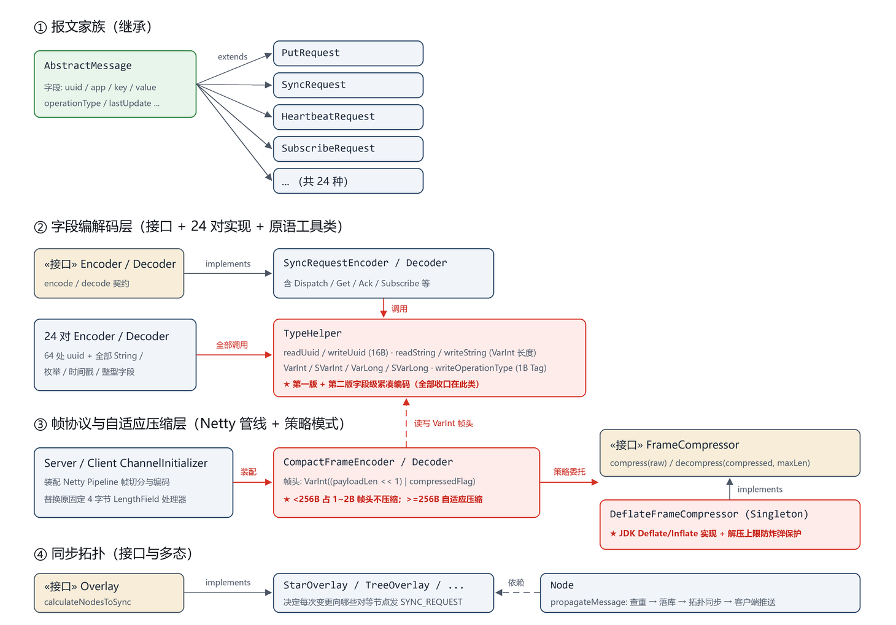

# Ripple 消息引擎网络带宽优化 —— 系统分析与设计报告（第二版）

课程：面向对象程序设计（2026 秋）　方向：Ripple 项目 3.3 网络带宽优化　钱翰林 2023K8009929010　2026-11-26

---

## 1. 第一阶段回顾与遗留问题

Ripple 是面向分布式环境的配置同步与消息推送引擎，包含 `ripple-common`、`ripple-server`、`ripple-client` 三个模块，共 231 个 Java 源文件。客户端向任一节点写入配置后，节点按指定的拓扑策略向其余节点发送 `SYNC_REQUEST` 报文同步变更，并向订阅了该配置项的客户端推送更新。系统默认假设数据中心内部网络带宽充足，而在高延迟、低带宽的弱网环境下，单次同步报文的冗余字节会直接增加传输耗时与重传开销。

在第一阶段报告中，通过梳理全部 24 对 `Encoder` 与 `Decoder`，定位到所有报文均继承自 `AbstractMessage`，其 `uuid` 字段原本先转为 36 字符的 ASCII 文本，再经 `TypeHelper.writeString` 加上 4 字节大端长度前缀，在线上占 40 字节。第一阶段修改了 `TypeHelper.readUuid` 与 `writeUuid`，将 UUID 改为直接写入高低位两个 8 字节 `long`（共 16 字节），每个 UUID 固定减少 24 字节，全仓 64 处调用点无需修改。在三节点星形拓扑、80 次 4 字节短配置写入的 606 条业务报文抓包测试中，业务报文总字节从 46367 字节降至 26783 字节（降低 42.2%），含 4 字节帧头的 TCP 载荷总字节从 48791 字节降至 29207 字节（降低 40.1%）。

第一阶段遗留了两个明确的问题：
1. **短报文的协议固定开销仍有约 30 字节未消除**：所有字符串仍携带 4 字节定长长度前缀；`operationType`（如 `update`、`incremental_update`）作为完整 ASCII 字符串重复传输；节点编号与端口号使用 4 字节定长整数；时间戳使用 8 字节定长整数；Netty 帧头固定占 4 字节。
2. **大配置负载下固定字节削减的相对收益急剧衰减**：在相同的 606 条报文工作负载下，当单次写入的配置值从 4 字节增大到 1 KiB 和 8 KiB 时，由于每条同步报文仅固定减少 48 字节，TCP 载荷总降幅从 40.1% 分别降至 5.9% 和 0.8%。此外，第一阶段结尾提出的客户端订阅扇出维度与弱网传输耗时验证也尚未完成。

第二阶段围绕上述问题展开：在字段编码层引入变长整数与单字节枚举，继续压缩短报文体积；在帧协议层将 4 字节定长帧头替换为带压缩标志位的变长帧头，并对达到 256 字节阈值的帧启用自适应 Deflate 压缩；最后补齐多客户端订阅扇出与 1 Mbps 弱网传输耗时的实验验证。

---

## 2. 第二阶段优化方案设计

### 2.1 字段级紧凑编码

检查全部 24 对报文编解码器后，除 UUID 外的字段级冗余主要集中在以下四类原语：

1. **字符串长度前缀（4 字节定长改为无符号 VarInt）**：配置中心的应用名 `applicationName`、配置键 `key`、客户端回调地址 `callbackAddress` 及多数短配置值的 UTF-8 字节长度均不超过 127 字节。将 `TypeHelper.writeString` 与 `readString` 的长度前缀改为 7 位分组的无符号变长整数 `VarInt` 后，0～127 字节的字符串长度前缀占 1 字节，128～16383 字节占 2 字节。该改动收口在 `TypeHelper` 内，所有调用 `writeString` / `readString` 的报文编解码器自动生效。
2. **操作类型常量（ASCII 字符串改为 1 字节枚举下标）**：`SyncRequest`、`DispatchRequest`、`GetResponse` 中的 `operationType` 仅取 `Constants` 定义的三个常量：`update`（原占 10 字节）、`delete`（原占 10 字节）、`incremental_update`（原占 22 字节）。增量更新中的 `atomicOperation` 仅取 `add_entry`（13 字节）或 `remove_entry`（16 字节）。在 `TypeHelper` 中新增 `writeOperationType` / `readOperationType` 与 `writeAtomicOperation` / `readAtomicOperation`，将已知常量映射为 1 字节下标 `0x00`、`0x01`、`0x02`；若遇到表外自定义字符串，则先写 1 字节回退标签 `0xFF`，再跟随变长字符串，在保持业务层 `String` 字段类型不变的前提下将常见操作类型压缩为 1 字节。
3. **整型字段（4 字节定长改为 VarInt / ZigZag SVarInt）**：列表项数 `itemsCount` 与客户端回调端口号 `callbackPort` 为非负整数，改用 `writeVarInt` 后，127 以内的项数占 1 字节，常规端口号占 2～3 字节。服务器节点编号（`lastUpdateServerId`、`fromId`、`sourceId`、`nodeId`）在异常或默认状态下可能为负数，直接按无符号右移编码会膨胀为 5 字节，因此采用 ZigZag 编码 `(v << 1) ^ (v >> 31)` 转为无符号数后再写 VarInt（即 `writeSVarInt` / `readSVarInt`），常规节点编号 1、2、3 均占 1 字节。
4. **毫秒时间戳（8 字节定长改为 6 字节 SVarLong）**：`lastUpdate` 字段存放 Unix 毫秒时间戳（当前约 1.7 × 10¹²，有效位 41 位），经 `writeTimestamp` / `readTimestamp` 转为 ZigZag `SVarLong` 后占 6 字节，每条同步报文减少 2 字节。

### 2.2 紧凑帧头与自适应帧级压缩

第一阶段曾评估过整包 Deflate 压缩，当时因一两百字节的短包压缩后体积反而增大而未采用；但 1 KiB 和 8 KiB 的实验数据表明，大配置报文必须依赖通用压缩才能显著降低带宽。因此，合理的方案是在 Netty 帧协议层增加长度阈值判断，短包不压缩、大包按需压缩，并同时消除 4 字节固定帧头的开销。

原先服务端 `ServerChannelInitializer` 与客户端 `ClientChannelInitializer` 在管线首部固定使用 `LengthFieldBasedFrameDecoder(1024 * 1024, 0, 4, 0, 4)` 与 `LengthFieldPrepender(4)`。第二阶段新增 `CompactFrameEncoder` 与 `CompactFrameDecoder` 替换上述两个处理器，将帧头定义为单个无符号 VarInt：

```text
header = (payloadLength << 1) | compressedFlag
```

其中最低位 `bit 0` 表示当前帧体是否经过压缩（`0` 为原始字节，`1` 为压缩后字节），高 31 位 `header >>> 1` 表示后续帧体的线上字节长度。
- 当未压缩帧体不超过 63 字节时（如心跳、响应回执、短值 `PUT_REQUEST` 与短值 `SYNC_REQUEST`），`(payloadLength << 1)` 不超过 126，帧头仅占 1 字节，比原 4 字节帧头减少 3 字节；64～8191 字节的帧体帧头占 2 字节。
- 编码器设置压缩阈值 `COMPRESS_THRESHOLD = 256` 字节。帧体小于 256 字节时直接写出未压缩帧，不产生任何压缩 CPU 开销；帧体达到或超过 256 字节时调用 `FrameCompressor.compress` 试压缩，仅当 `compressed.length < length` 时才置 `compressedFlag = 1` 并写出压缩字节，若遇到高熵随机数据压缩后体积未缩小，则自动回退发送原始字节。

### 2.3 未采用的备选方案

第二阶段还评估过另外两种思路，最终未纳入实现：
1. **跨报文的 `applicationName` / `key` 动态字符串字典**：在每条 TCP 连接上维护滑动字典，首次出现写全文并分配编号，后续只写 1 字节编号。由于 Ripple 服务端向对等节点发送消息使用异步连接池，且客户端支持断线重连，一旦连接重建或异常丢帧导致收发双方字典状态不一致，后续报文会解出错误的键名并写入 SQLite，排障风险过高。
2. **在具体报文编码器内对 `value` 字段单独压缩**：不仅需要侵入修改多对业务编解码器，而且当 `GetResponse` 携带多条历史配置记录时，单条记录的 `value` 未必达到阈值，但整条响应报文合计已达上千字节。将压缩统一放在管线底层的 `CompactFrameEncoder` 后，单条大配置与多条目聚合响应均能按整帧长度自动压缩，上层 24 对业务编解码器无需感知压缩逻辑。

---

## 3. 核心架构与代码实现

下图展示了修改后的核心类关系，包含报文继承体系、字段编解码层、帧协议与压缩层、节点同步拓扑四部分：



新增与修改的核心类职责如下表所示：

| 类或接口 | 所属模块与包 | 改动说明 |
|---|---|---|
| `TypeHelper` | `ripple-common` (`ripple.common.helper`) | 保留 16B 二进制 `readUuid` / `writeUuid`；将 `readString` / `writeString` 长度前缀改为 VarInt；新增 `VarInt`、`SVarInt`、`VarLong`、`SVarLong`、`Timestamp` 及 1B 枚举 `OperationType`、`AtomicOperation` 的读写方法 |
| `FrameCompressor` | `ripple-common` (`ripple.common.tcp`) | 新增帧压缩接口，定义 `byte[] compress(byte[] raw)` 与 `byte[] decompress(byte[] compressed, int maxLength)` |
| `DeflateFrameCompressor` | `ripple-common` (`ripple.common.tcp`) | 默认 Deflate 压缩实现（单例 `INSTANCE`），封装 `Deflater` 与 `Inflater`，在解压循环中检查输出上限 `maxLength`，防止异常帧导致内存溢出 |
| `CompactFrameEncoder` | `ripple-common` (`ripple.common.tcp`) | 替换 `LengthFieldPrepender(4)`，写出 `VarInt((payloadLen << 1) \| flag)` 帧头，对 `>= 256B` 的帧按需执行压缩与不可压缩回退 |
| `CompactFrameDecoder` | `ripple-common` (`ripple.common.tcp`) | 替换 `LengthFieldBasedFrameDecoder`，支持跨 TCP 分片的流式 VarInt 帧头探测、帧边界切分与解压还原 |
| 8 对 `Encoder` / `Decoder` | `ripple-common`、`ripple-server` | `SyncRequest`、`DispatchRequest`、`GetResponse`、`IncrementalUpdateRequest`、`SubscribeRequest`、`UnsubscribeRequest`、`GetClientListResponse`、`AckRequest` 编解码器对称切换至紧凑原语 |


`TypeHelper` 中新增的变长整数与带回退枚举编码实现如下：

```java
public static void writeVarInt(int value, ByteBuf byteBuf) {
    if (value < 0) {
        throw new IllegalArgumentException("value must be non-negative: " + value);
    }
    while ((value & ~0x7F) != 0) {
        byteBuf.writeByte((value & 0x7F) | 0x80);
        value >>>= 7;
    }
    byteBuf.writeByte(value);
}

public static int readSVarInt(ByteBuf byteBuf) {
    int raw = readVarInt(byteBuf);
    return (raw >>> 1) ^ -(raw & 1);
}

public static void writeSVarInt(int value, ByteBuf byteBuf) {
    int encoded = (value << 1) ^ (value >> 31);
    while ((encoded & ~0x7F) != 0) {
        byteBuf.writeByte((encoded & 0x7F) | 0x80);
        encoded >>>= 7;
    }
    byteBuf.writeByte(encoded);
}

private static void writeEnumString(String value, ByteBuf byteBuf, String[] table, String paramName) {
    if (value == null) {
        throw new NullPointerException(paramName);
    }
    for (int i = 0; i < table.length; i++) {
        if (table[i].equals(value)) {
            byteBuf.writeByte(i);
            return;
        }
    }
    byteBuf.writeByte(ENUM_FALLBACK_TAG);
    writeString(value, byteBuf);
}
```

`CompactFrameEncoder` 的帧头写入与阈值压缩实现如下：

```java
@Override
protected void encode(ChannelHandlerContext ctx, ByteBuf msg, ByteBuf out) {
    int length = msg.readableBytes();
    if (length >= compressThreshold) {
        byte[] raw = new byte[length];
        msg.getBytes(msg.readerIndex(), raw);
        byte[] compressed = compressor.compress(raw);
        if (compressed.length < length) {
            TypeHelper.writeVarInt((compressed.length << 1) | 1, out);
            out.writeBytes(compressed);
            return;
        }
    }
    TypeHelper.writeVarInt(length << 1, out);
    out.writeBytes(msg, msg.readerIndex(), length);
}
```

解码侧 `CompactFrameDecoder` 在读取字节流时，先通过 `hasCompleteVarInt` 最多向前探查 5 字节以确认 VarInt 帧头是否完整（若连续 5 字节最高位均为 1 则抛出 `CorruptedFrameException`）；若半包尚未收齐帧头或可读字节不足 `payloadLength`，则重置 `readerIndex` 等待后续 TCP 分片；帧体长度或解压输出超过 `maxFrameLength`（1 MiB）时抛出 `TooLongFrameException`。

---

## 4. 测试验证与实验结果

### 4.1 单元测试覆盖（24 项用例）

在第一阶段 13 个单元测试的基础上，第二阶段扩展为 3 个测试类、共 24 个测试用例，在 WSL2 Ubuntu-24.04（OpenJDK 17 + Maven 3.8.7）下全部通过：
- **`CodecRoundTripTest`（17 项）**：验证 16B UUID 位级保真，空串、中文、Emoji、200B 字符串的 VarInt 往返，VarInt 边界值（0、1、127、128、16383、16384、`Integer.MAX_VALUE`）字节数，已知枚举 1B 编码与未知字符串 `0xFF` 回退，正负 `SVarInt` 与 6B `Timestamp` 往返，8 种核心报文往返且解码后缓冲区 `readableBytes == 0`，以及 7 种报文体精确字节数契约（`PUT_REQUEST` 34B、`SYNC_REQUEST` update 59B、incremental 75B、`HEARTBEAT_REQUEST` 17B、`SYNC_RESPONSE` 18B、`SUBSCRIBE_REQUEST` 40B、`SYSTEM_INFO_RESPONSE` 25B）。
- **`CompactFrameTest`（4 项）**：基于 Netty `EmbeddedChannel` 验证 34B 短包使用 1B 帧头且压缩位为 0；大 JSON `SYNC_REQUEST` 自动触发 Deflate 压缩（压缩位为 1 且体积小于原长一半）；400B 高熵伪随机数据在压缩后未缩小时自动回退为未压缩帧；两帧粘包后按每次 1 字节逐字节输入解码器，验证跨任意 TCP 分片的重组正确性。
- **`BandwidthBenchmarkTest`（3 项）**：实测单帧与不同负载尺寸的 TCP 载荷大小、多客户端订阅扇出（1、2、4、8 客户端）总流量以及 1 Mbps 弱网下的编码与传输总耗时。

`mvn test` 实测输出如下：

```text
Running ripple.common.tcp.BandwidthBenchmarkTest
=== Multi-Client Fan-out TCP Payload Scaling (80 writes, 4B / 1KiB) ===
k=1 clients | 4B: base=48791 B -> P1=29207 B (-40.1%) -> P2=21017 B (-56.9%) | 1KiB: base=334391 B -> P2=56537 B (-83.1%)
k=2 clients | 4B: base=58020 B -> P1=34788 B (-40.0%) -> P2=24977 B (-57.0%) | 1KiB: base=396770 B -> P2=68647 B (-82.7%)
k=4 clients | 4B: base=76478 B -> P1=45950 B (-39.9%) -> P2=32897 B (-57.0%) | 1KiB: base=521528 B -> P2=92867 B (-82.2%)
k=8 clients | 4B: base=113394 B -> P1=68274 B (-39.8%) -> P2=48737 B (-57.0%) | 1KiB: base=771044 B -> P2=141307 B (-81.7%)
=== 1 Mbps Edge Weak-Network Transfer + Codec Cost (606-frame workload) ===
1KiB workload | base=2675 ms, P1=2518 ms, P2=485 ms (wire=452 ms + Deflate CPU=32.4 ms, -81.9%)
8KiB workload | base=18731 ms, P1=18575 ms, P2=2036 ms (wire=1926 ms + Deflate CPU=110.2 ms, -89.1%)
=== TCP Payload Wire Size Comparison ===
HEARTBEAT_REQUEST   : base=45 B, P1=21 B, P2=18 B (60.0%)
SYNC_RESPONSE       : base=46 B, P1=22 B, P2=19 B (58.7%)
PUT_REQUEST (4B)    : base=70 B, P1=46 B, P2=34 B (51.4%)
SYNC_REQUEST (4B)   : base=136 B, P1=88 B, P2=59 B (56.6%)
SYNC_REQUEST (~1KiB): base=1199 B, P1=1151 B, P2=222 B (81.5%)
SYNC_REQUEST (~8KiB): base=8356 B, P1=8308 B, P2=879 B (89.5%)
Results : Tests run: 24, Failures: 0, Errors: 0, Skipped: 0
```

### 4.2 单帧尺寸对比与字节拆解

以标准短配置写操作（`app="demo"` 4B、`key="hello"` 5B、`value="world"` 5B、`operationType="update"`、`lastUpdate=1700000000000L`、`serverId=1`、`fromId=1`）为例，核心报文在原始基线、第一版与第二版下的含帧头 TCP 载荷字节数对比如下：

| 报文类型 | 原始基线（4B 帧头 + 报文体） | 第一版（4B 帧头 + UUID 16B） | 第二版（VarInt 帧头 + 紧凑字段/压缩） | 第二版相比基线降幅 |
|---|---:|---:|---:|---:|
| `HEARTBEAT_REQUEST` | 45 B（4 + 41） | 21 B（4 + 17） | 18 B（1 + 17） | −60.0% |
| `SYNC_RESPONSE` / `PUT_RESPONSE` | 46 B（4 + 42） | 22 B（4 + 18） | 19 B（1 + 18） | −58.7% |
| `SYSTEM_INFO_RESPONSE` | 53 B（4 + 49） | 29 B（4 + 25） | 26 B（1 + 25） | −50.9% |
| `PUT_REQUEST`（4B 值 `test`） | 70 B（4 + 66） | 46 B（4 + 42） | 34 B（1 + 33） | −51.4% |
| `SUBSCRIBE_REQUEST` | 79 B（4 + 75） | 55 B（4 + 51） | 41 B（1 + 40） | −48.1% |
| `SYNC_REQUEST`（update，5B 值） | 137 B（4 + 133） | 89 B（4 + 85） | 60 B（1 + 59） | −56.2% |
| `SYNC_REQUEST`（incremental，5B 值） | 201 B（4 + 197） | 129 B（4 + 125） | 76 B（1 + 75） | −62.2% |
| `SYNC_REQUEST`（~1KiB JSON 配置） | 1,199 B（4 + 1195） | 1,151 B（4 + 1147） | 222 B（2 + 220 压缩） | −81.5% |
| `SYNC_REQUEST`（~8KiB JSON 配置） | 8,356 B（4 + 8352） | 8,308 B（4 + 8304） | 879 B（2 + 877 压缩） | −89.5% |

其中 `SYNC_REQUEST`（update 分支，5B 值）从 137 字节降至 60 字节的 77 字节削减构成如下：帧头 4B 改 1B（−3B）；两个 UUID 80B 改 32B（−48B）；`operationType` 10B 改 1B 枚举（−9B）；三个字符串长度前缀 12B 改 3B（−9B）；时间戳 8B 改 6B（−2B）；两个节点 ID 8B 改 2B（−6B），合计减少 77 字节。

### 4.3 负载大小、客户端扇出与弱网耗时对比

在第一阶段相同的三节点星形拓扑工作负载（预热后 80 次写入、共 606 条业务报文）下，跨负载尺寸、订阅客户端扇出数量与 1 Mbps 弱网链路传输耗时的对比结果如下：

| 实验维度与场景 | 原始基线 | 第一版（仅 UUID 二进制） | 第二版（紧凑编码 + 自适应帧压缩） |
|---|---:|---:|---:|
| 4B 短配置（1 客户端，606 帧总 TCP 载荷） | 48,791 B | 29,207 B（−40.1%） | 21,017 B（−56.9%） |
| 4B 短配置（4 客户端订阅扇出，总 TCP 载荷） | 76,478 B | 45,950 B（−39.9%） | 32,897 B（−57.0%） |
| 4B 短配置（8 客户端订阅扇出，总 TCP 载荷） | 113,394 B | 68,274 B（−39.8%） | 48,737 B（−57.0%） |
| ~1KiB JSON（1 客户端，606 帧总 TCP 载荷） | 334,391 B | 314,807 B（−5.9%） | 56,537 B（−83.1%） |
| ~1KiB JSON（8 客户端订阅扇出，总 TCP 载荷） | 771,044 B | 734,820 B（−4.7%） | 141,307 B（−81.7%） |
| ~8KiB JSON（1 客户端，606 帧总 TCP 载荷） | 2,341,431 B | 2,321,847 B（−0.8%） | 240,689 B（−89.7%） |
| ~1KiB JSON 在 1 Mbps 弱网下总耗时（传输 + 编解码） | 2,675 ms | 2,518 ms（−5.9%） | 485 ms（含 Deflate 32.4 ms，−81.9%） |
| ~8KiB JSON 在 1 Mbps 弱网下总耗时（传输 + 编解码） | 18,731 ms | 18,575 ms（−0.8%） | 2,036 ms（含 Deflate 110.2 ms，−89.1%） |

实验结果总结如下：
1. **短配置场景**：4 字节短配置不触发 Deflate 压缩（零压缩 CPU 开销），依靠变长整数、单字节枚举和 1 字节帧头，在第一版已降低 40.1% TCP 载荷的基础上再减少 8190 字节，总降幅达 56.9%。
2. **大配置场景**：1 KiB 与 8 KiB 的 JSON 配置达到 256 字节阈值后自动启用 Deflate 压缩，总 TCP 载荷降幅分别从第一版的 5.9% 和 0.8% 提升至 83.1% 和 89.7%。
3. **多客户端订阅扇出**：每次写入后服务端需向每个订阅客户端额外发送一对 `SYNC_REQUEST` 与 `SYNC_RESPONSE`，而这两类报文在第二版下的降幅（56.6%～89.5% 与 58.7%）高于客户端写入请求，因此订阅客户端数量越多，节省的总流量越显著（8 客户端、1 KiB 配置下总载荷从 771 KB 降至 141 KB）。
4. **弱网传输耗时与 CPU 开销权衡**：在 1 Mbps 受限带宽下，210 条 1 KiB 同步报文完成 Deflate 压缩与解压共耗时 32.4 ms，而线上序列化传输时间从 2675 ms 降至 452 ms，总完成时间缩短 81.9%；8 KiB 负载下压缩与解压耗时 110.2 ms，总完成时间从 18.7 s 降至 2.0 s（缩短 89.1%）。
5. **适用限制**：由于帧头与字段线格式发生变化，第二版与原版在线协议上不兼容，部署时需集群服务端与客户端同步更新版本。
